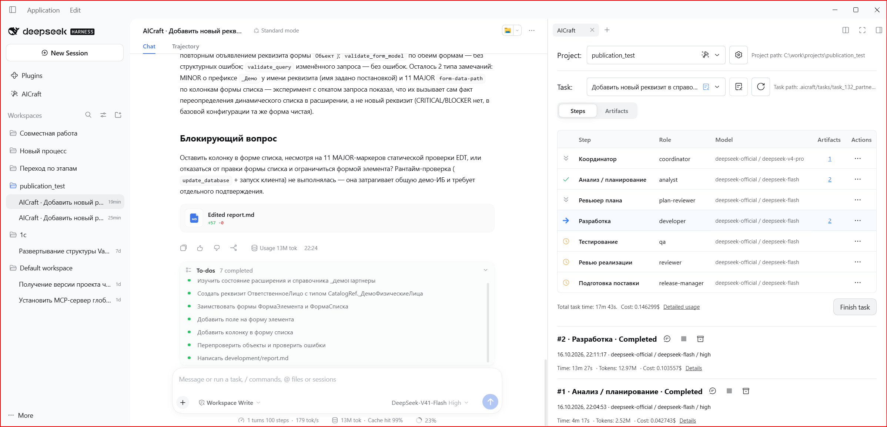

# AICraft

[Русский](README.md) | English

A [DeepSeek Harness](https://github.com/deepseek-ai/deepseek-harness) plugin for configuring agent workflows for different types of tasks. For each process, you define the steps, roles, instructions, and executor models.

When creating a task, you select a suitable process. AICraft helps you follow its steps: launch executors, review results, and keep work artifacts.

## Features

- A workflow builder for different types of tasks.
- Project rules, role instructions, and editable step prompts.
- Model selection for each step or individual run, with separate executor chats.
- Artifacts, run history, execution time, and task expenses (DeepSeek models only).
- Complete, skip, and repeat steps; finish and reopen tasks.
- Collaboration through Git: settings and task data are stored in project files.



## Getting started

1. Open your project in DSH and select it in the **Project** field of the plugin panel.
2. Click **Init new AICraft project**. Choose to create a new process or start from a bundled example.
3. In **Project settings**, describe the shared **Project rules**, define the **Roles**, and configure the work steps (**Steps**).
4. Once configured, click **Create first task**. Enter the task title, process, requirements, and acceptance criteria.
5. On the **Steps** tab, open the current step's menu. Use **Input prompt** to review the executor's assignment and save any changes you need.
6. Select the step's model and click **Run**. Results appear in the executor's chat; created files are available on the **Artifacts** tab.
7. Review the result. If more work is needed, continue the chat or run the step again. Once you accept the step, select **Complete** to move to the next one.
8. When the task is complete, click **Finish Task**. The task, chats, and artifacts are preserved. If needed, reopen the completed task with **Reopen Task**, provided there is no other open task in the project (branch).

[Additional information about using the plugin.](docs/usage.en.md)

## Installation

> Before asking an agent to install the plugin, switch to **Creator mode**.

1. Install [DeepSeek Harness](https://github.com/deepseek-ai/deepseek-harness) version **0.2.0-rc.2**.
2. Download the latest version of the plugin from [Releases](https://github.com/ChernyakAI/dsh-aicraft/releases).
3. In DSH, open **Plugins → Add plugin**, enter the path to the downloaded archive, and install it. Do not unpack the archive. Access to the npm registry is required to install dependencies.
4. Fully quit DSH and launch it again. In Desktop, use **Quit DeepSeek Harness**: closing the window may leave the application running in the system tray.
5. Open **AICraft** in the sidebar.

If you use the CLI, add the archive to the profile you use to run DSH:

```sh
dsh plugin --profile <profile> add "<path>/dsh-aicraft-<version>.tgz"
```

Desktop uses the `desktop` profile; the standard Web setup uses `web`. The `dsh` command must belong to your DSH installation.

## Updating and uninstalling

Wait for the agent to finish its work. Remove the previous plugin through **Plugins**, install the new `.tgz`, and fully restart DSH. Removing the package preserves the `.aicraft/` files in your projects.

If AICraft does not appear or a new command returns HTTP 404, check the DSH version and selected profile, and make sure you fully quit the application before restarting it.

---

[Information for agents](docs/agents/README.md).

## License

AICraft is distributed under the [MIT License](LICENSE). Third-party code notices: [THIRD_PARTY_NOTICES.md](THIRD_PARTY_NOTICES.md).
