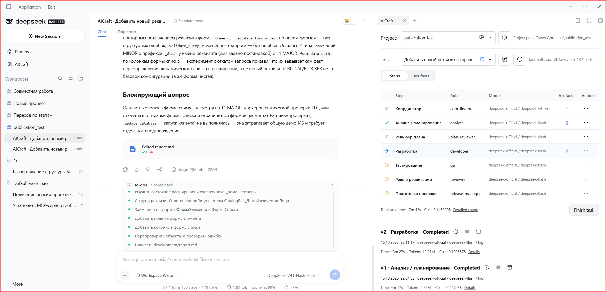

# AICraft

[Русский](README.md) | English

A [DeepSeek Harness](https://github.com/deepseek-ai/deepseek-harness) plugin for configuring agent workflows for different types of tasks. For each process, you define the steps, roles, instructions, and executor models.

When creating a task, you select a suitable process. AICraft helps you follow its steps: launch executors, review results, and keep work artifacts.

## Features

- A workflow builder for different types of tasks.
- Project rules, role instructions, and editable step prompts.
- Agent task coordination: launch executors, review results and move between stages.
- Model selection for each step or individual run, with separate executor chats.
- Artifacts, run history, execution time, and task expenses (DeepSeek models only).
- Complete, skip, and repeat steps; finish and reopen tasks.
- Collaboration through Git: settings and task data are stored in project files.

## Getting started

1. Open your project in DSH and select it in the **Project** field of the plugin panel.
2. Click **Init new AICraft project**. Choose to create a new process or start from a bundled example.
3. In **Project settings**, describe the shared **Project rules**, define the **Roles**, and configure the work steps (**Steps**).
4. Once configured, click **Create first task**. Enter the task title, process, requirements, and acceptance criteria.
5. On the **Steps** tab, open the current step's menu. Use **Input prompt** to review the executor's assignment and save any changes you need.
6. Select the step's model and click **Run**. Results appear in the executor's chat; created files are available on the **Artifacts** tab.
7. Review the result. If more work is needed, continue the chat or run the step again. Once you accept the step, select **Complete** to move to the next one.
8. When the task is complete, click **Finish Task**. The task, chats, and artifacts are preserved. If needed, reopen the completed task with **Reopen Task**, provided there is no other open task in the project (branch).

[Additional information about using the plugin.](docs/usage.en.md)

## Installation

Requires [DeepSeek Harness](https://github.com/deepseek-ai/deepseek-harness) **0.2.2-rc.3**. Choose an installation method:

- **Discover** — add the AICraft index source, find the plugin and click **Install**.
- **GitHub Releases** — download the `.tgz` from [Releases](https://github.com/ChernyakAI/dsh-aicraft/releases) and install it through **Plugins → Add plugin**.

Fully quit and restart DSH, then open **AICraft** in the sidebar. Both methods provide a ready plugin; no build is required.

[More about installing, updating and uninstalling.](docs/install.en.md)

---

[Information for agents](docs/agents/README.md).

## License

AICraft is licensed under [AGPL-3.0-only](LICENSE).

[Distribution terms](docs/license.en.md) · [Third-party notices](THIRD_PARTY_NOTICES.en.md).
