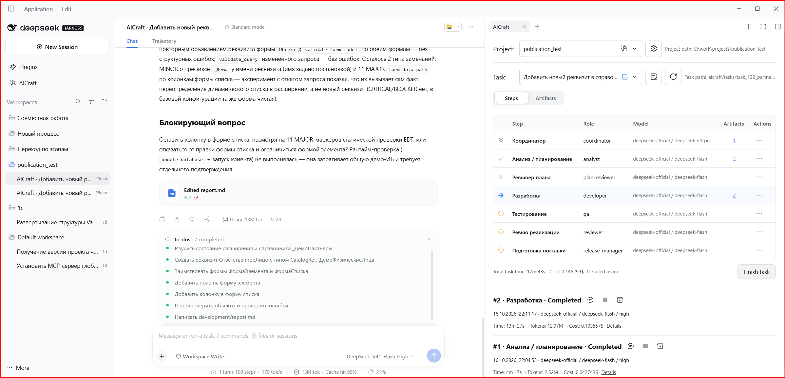

# AICraft

Русский | [English](README.en.md)

Плагин для [DeepSeek Harness](https://github.com/deepseek-ai/deepseek-harness), который позволяет настраивать процессы работы с агентом под разные типы задач. Для каждого процесса вы определяете этапы, роли, инструкции и модели исполнителей.

При создании задачи выбирается подходящий процесс. AICraft помогает пройти его по этапам: запускать исполнителей, проверять результаты и сохранять артефакты работы.

## Возможности

- Конструктор workflow под разные типы задач.
- Правила проекта, инструкции ролей и редактируемые промпты этапов.
- Координация задачи агентом: запуск исполнителей, проверка результатов и переходы между этапами.
- Выбор модели для этапа или отдельного запуска, отдельные чаты исполнителей.
- Просмотр артефактов, истории запусков, времени работы и расходов на задачу (только для моделей DeepSeek).
- Завершение, пропуск и повторное выполнение этапов; завершение и переоткрытие задач.
- Совместная работа через Git: настройки и данные задач хранятся в файлах проекта.

## Начало работы

1. Откройте рабочий проект в DSH и выберите его в поле **Project** панели плагина.
2. Нажмите **Init new AICraft project**. Выберите создание нового процесса (или из поставляемого примера).
3. В настройках процесса (**Project settings**) опишите общие правила работы с проектом (**Project rules**), определите перечень ролей (**Roles**) и состав работ (**Steps**).
4. После настройки нажмите **Create first task**. Укажите название задачи, процесс, постановку и условия приёмки.
5. Во вкладке **Steps** откройте меню текущего этапа. Через **Input prompt** проверьте задание исполнителю и при необходимости сохраните изменения.
6. Выберите модель этапа и нажмите **Run**. Результат появится в чате исполнителя; созданные файлы доступны во вкладке **Artifacts**.
7. Проверьте результат. Если нужна доработка, продолжите чат или повторите запуск. Когда этап принят, выберите **Complete** для перехода к следующему.
8. После выполнения задачи нажмите **Finish Task**. Задача, чаты и артефакты сохраняются. При необходимости переоткройте завершённую задачу кнопкой **Reopen Task**, если в проекте (ветке) нет другой открытой задачи.

[Дополнительная информация о работе плагина.](docs/usage.md)

## Установка

Требуется [DeepSeek Harness](https://github.com/deepseek-ai/deepseek-harness) **>=0.2.2-rc.5**. Выберите способ установки:

- **Discover** — добавьте источник индекса AICraft, найдите плагин и нажмите **Install**.
- **GitHub Releases** — скачайте `.tgz` из [Releases](https://github.com/ChernyakAI/dsh-aicraft/releases) и установите через **Plugins → Add plugin**.

Полностью завершите DSH и запустите заново, затем откройте **AICraft** в боковой панели. Оба способа предоставляют готовый плагин; сборка не требуется.

[Подробнее об установке, обновлении и удалении.](docs/install.md)

---

[Информация для агентов](docs/agents/README.md).

## Лицензия

AICraft распространяется под [AGPL-3.0-only](LICENSE).

[Условия распространения](docs/license.md) · [Сторонние уведомления](THIRD_PARTY_NOTICES.md).
